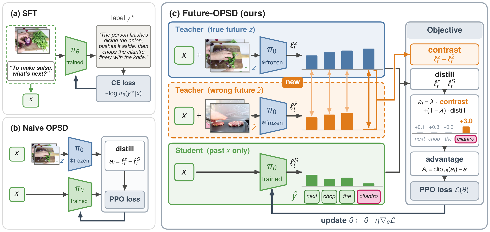

<div align="center">
<h1>Learning Video Foresight Reasoning from<br>Unlabeled Videos via On-Policy Self-Distillation</h1>

[Jingchen Sun](https://jingchensun.github.io/)<sup>1*</sup>, Jiaxing Zhang<sup>6*</sup>, Qingqiao Hu<sup>2</sup>, Dingqiang Ye<sup>3</sup>, Yuqi Jia<sup>4</sup>, Yijun Liang<sup>5</sup>, Di Fu<sup>6</sup>, Yunjie Tian<sup>6</sup>, Dongdi Zhao<sup>6†</sup>, [Changyou Chen](https://cse.buffalo.edu/~changyou/)<sup>1</sup>

<sup>1</sup> University at Buffalo &nbsp;&nbsp; <sup>2</sup> Stony Brook University &nbsp;&nbsp; <sup>3</sup> Johns Hopkins University &nbsp;&nbsp; <sup>4</sup> Duke University<br>
<sup>5</sup> University of Maryland, College Park &nbsp;&nbsp; <sup>6</sup> Independent Researcher

[](https://jingchensun.github.io/future-opsd/)
[](https://github.com/Jingchensun/future-opsd)
[](https://huggingface.co/jsun39)
[](https://opensource.org/licenses/Apache-2.0)
</div>

## Introduction

Video foresight reasoning asks a vision-language model to anticipate future events or next actions from the video it has
observed so far. We propose **Future-OPSD**, an on-policy self-distillation framework that turns past–future video pairs
into a self-supervised training signal, with no answer labels, no reasoning traces and no external reward model.
The student sees only the observed video and samples its own reasoning and answer; a frozen copy of the same model scores
every sampled token once with the **real future** and once with the future of an **unrelated video**. The per-token
advantage combines this contrast with the teacher–student distillation term,

```math
A_t=\lambda\,(\ell^{z}_t-\ell^{\tilde z}_t)+(1-\lambda)\,(\ell^{z}_t-\ell^{S}_t),
```

which amplifies decision-relevant content of the real future and suppresses the content-independent effect of seeing
*some* future ($\lambda=0$ recovers Naive OPSD). [[Project Page](https://jingchensun.github.io/future-opsd/)]

<div align="center">

</div>

## 📸 Release

* **`Nov. 2026`**: The training and evaluation code is available, together with Future-OPSD checkpoints of
  Qwen3-VL-8B-Instruct and Qwen3.5-9B trained on Future-L1-50K and on EgoPlan-IT
  ([Hugging Face](https://huggingface.co/jsun39)).

## 🦙 Model Zoo

Future-OPSD checkpoints (z = future frames, λ = 0.75, 100 steps × 256 prompts), laid out like Tables 1 and 2 of the paper.
Each checkpoint is chosen among three training seeds as the one with the fewest scores below the base model (ties broken
by the smallest total shortfall, then by the in-domain score). All numbers are measured with the evaluation protocol of
this repository ([3.1](#31-evaluate-the-released-checkpoints)); "General Video Avg" averages TempCompass, TemporalBench,
Video-MME and MVBench, and bold marks the higher score of each pair.

**Trained on Future-L1-50K** (Table 1 setting)

<table>
<thead>
<tr><th rowspan="2">Model</th><th rowspan="2">Method</th><th colspan="3">TwiFF-Bench (in-domain)</th><th colspan="3">SEED-Bench-R1</th><th rowspan="2">General<br>Video Avg</th></tr>
<tr><th>CoT</th><th>Ans.</th><th>Avg</th><th>L1</th><th>L2</th><th>L3</th></tr>
</thead>
<tbody>
<tr><td rowspan="3"><b>Qwen3-VL-8B</b></td><td>Base</td><td>58.6</td><td>48.7</td><td>53.6</td><td>45.4</td><td>47.5</td><td>39.7</td><td>56.0</td></tr>
<tr><td><a href="https://huggingface.co/jsun39/Future-OPSD-Qwen3-VL-8B-Future-L1"><b>Future-OPSD</b></a></td><td><b>70.8</b></td><td><b>61.5</b></td><td><b>66.1</b></td><td><b>45.9</b></td><td><b>48.4</b></td><td><b>40.1</b></td><td><b>57.3</b></td></tr>
<tr><td><i>Δ vs. Base</i></td><td><i>+12.2</i></td><td><i>+12.8</i></td><td><i>+12.5</i></td><td><i>+0.5</i></td><td><i>+0.9</i></td><td><i>+0.4</i></td><td><i>+1.3</i></td></tr>
<tr><td rowspan="3"><b>Qwen3.5-9B</b></td><td>Base</td><td>62.4</td><td>54.5</td><td>58.5</td><td>44.3</td><td>44.9</td><td>37.9</td><td>57.0</td></tr>
<tr><td><a href="https://huggingface.co/jsun39/Future-OPSD-Qwen3.5-9B-Future-L1"><b>Future-OPSD</b></a></td><td><b>69.9</b></td><td><b>65.7</b></td><td><b>67.8</b></td><td><b>45.4</b></td><td><b>47.1</b></td><td><b>38.0</b></td><td><b>57.2</b></td></tr>
<tr><td><i>Δ vs. Base</i></td><td><i>+7.5</i></td><td><i>+11.2</i></td><td><i>+9.3</i></td><td><i>+1.1</i></td><td><i>+2.2</i></td><td><i>+0.1</i></td><td><i>+0.2</i></td></tr>
</tbody>
</table>

**Trained on EgoPlan-IT** (Table 2 setting)

<table>
<thead>
<tr><th rowspan="2">Model</th><th rowspan="2">Method</th><th colspan="3">SEED-Bench-R1 (in-domain)</th><th colspan="3">TwiFF-Bench</th><th rowspan="2">General<br>Video Avg</th></tr>
<tr><th>L1</th><th>L2</th><th>L3</th><th>CoT</th><th>Ans.</th><th>Avg</th></tr>
</thead>
<tbody>
<tr><td rowspan="3"><b>Qwen3-VL-8B</b></td><td>Base</td><td>45.4</td><td>47.5</td><td>39.7</td><td>58.6</td><td>48.7</td><td>53.6</td><td>56.0</td></tr>
<tr><td><a href="https://huggingface.co/jsun39/Future-OPSD-Qwen3-VL-8B-EgoPlan-IT"><b>Future-OPSD</b></a></td><td><b>54.4</b></td><td><b>56.5</b></td><td><b>50.2</b></td><td><b>65.1</b></td><td><b>55.0</b></td><td><b>60.0</b></td><td><b>56.2</b></td></tr>
<tr><td><i>Δ vs. Base</i></td><td><i>+9.0</i></td><td><i>+9.0</i></td><td><i>+10.5</i></td><td><i>+6.5</i></td><td><i>+6.3</i></td><td><i>+6.4</i></td><td><i>+0.2</i></td></tr>
<tr><td rowspan="3"><b>Qwen3.5-9B</b></td><td>Base</td><td>44.3</td><td>44.9</td><td>37.9</td><td>62.4</td><td>54.5</td><td>58.5</td><td>57.0</td></tr>
<tr><td><a href="https://huggingface.co/jsun39/Future-OPSD-Qwen3.5-9B-EgoPlan-IT"><b>Future-OPSD</b></a></td><td><b>57.9</b></td><td><b>58.3</b></td><td><b>54.2</b></td><td><b>63.7</b></td><td><b>57.9</b></td><td><b>60.8</b></td><td><b>57.4</b></td></tr>
<tr><td><i>Δ vs. Base</i></td><td><i>+13.6</i></td><td><i>+13.4</i></td><td><i>+16.3</i></td><td><i>+1.3</i></td><td><i>+3.4</i></td><td><i>+2.3</i></td><td><i>+0.4</i></td></tr>
</tbody>
</table>

## 🗂️ Repository layout

```
config/       paths.sh / paths.py (DATA_ROOT, CKPT_ROOT, OUTPUT_ROOT, ENV_ROOT), OPSD system prompt, chat template, deepspeed config
env/          install_env.sh (rebuilds each environment from its exact package lock in lock/), ENVIRONMENT.md
train/        train_opsd.sh (Naive OPSD / Future-OPSD), train_grpo.sh (TTRL baseline), train_sft_text.sh (SFT baseline)
  rl/         verl / EasyR1-based trainer for Qwen3-VL (vLLM 0.11); Future-OPSD advantage in verl/trainer/ray_trainer.py
  rl_qwen35/  the same trainer ported to Qwen3.5 (transformers 5, vLLM 0.30)
  sft/        HF SFT trainer
eval/         eval_egoplan_suite.sh (TwiFF-Bench, SEED-Bench-R1, TempCompass, Video-MME, MVBench), eval_model.sh (TwiFF-Bench
              + judge), eval_video3.sh (SEED-Bench-R1 / TempCompass / TemporalBench), eval_general.sh (Video-MME / MVBench), scorers
  lmms-eval/  evaluation framework (task configs read ${DATA_ROOT})
data_tools/   download/public.py (all third-party data), make_egoplan_train.py (EgoPlan-IT), layout.py
utils/        gpu_clean.sh, make_sft_base.sh, make_hf_eval.sh
```

---

## 🛠️ 1. Environment

### 1.1 Hardware and paths

All results were produced on **8 × NVIDIA B200** per run (Linux, system Python 3.11, virtualenvs). B200 (sm_100) needs
CUDA 12.8+ builds of torch. Other GPUs have not been tested; the batch and vLLM memory settings were chosen for the B200's
180 GB, so smaller GPUs may need a lower `worker.rollout.gpu_memory_utilization` or micro batch size.

Every script reads its paths from `config/paths.sh`. Edit it, or export these before running anything:

```bash
export DATA_ROOT=/path/to/data        # datasets (default ./dataset)
export CKPT_ROOT=/path/to/ckpt        # base models and training checkpoints (default ./ckpt)
export OUTPUT_ROOT=/path/to/output    # evaluation results and training logs (default ./output)
export ENV_ROOT=/path/to/envs         # virtualenvs (default ./envs)
```

### 1.2 Which environment for what

Training and evaluation use **different** environments for Qwen3-VL and **the same** environment for Qwen3.5:

| env (`$ENV_ROOT/<env>`) | used for | torch / CUDA | key packages |
|-|-|-|-|
| `future-l1-rl-vllm011` | **Qwen3-VL training** (Naive OPSD, Future-OPSD, TTRL) and FSDP → HF checkpoint merging | 2.8.0 / cu12.8 | vLLM **0.11.0**, transformers 4.57.1, flash-attn 2.8.3, ray 2.58 |
| `future-l1-rl` | **Qwen3-VL evaluation** (lmms-eval, vLLM backend) | 2.9.1 / cu12.8 | vLLM **0.16.0**, transformers 4.57.1, flash-attn 2.8.3, lmms-eval |
| `future-l1-q35` | **Qwen3.5 training, SFT and evaluation** (`train/rl_qwen35`) | 2.13.0 / cu13.0 | vLLM **0.30.0**, transformers **5.17.0**, deepspeed 0.18.4, lmms-eval |
| `judge-vllm` | **TwiFF-Bench judge** (Qwen3.6-27B served by vLLM) | 2.13.0 / cu13.0 | vLLM 0.30.0, transformers 5.17.0 |
| `future-l1-sft` | **Qwen3-VL SFT** baseline (`train/sft`, deepspeed ZeRO-2) | 2.9.1 / cu12.8 | transformers 4.57.1, deepspeed 0.18.2, flash-attn 2.8.3 |

Why the split:

- **Qwen3-VL training is pinned to vLLM 0.11.0.** The trainer replaces vLLM's GPU model runner so that the frozen teacher
  can score the student's tokens with the privileged future frames, and that runner only matches the vLLM 0.11.0
  internals. Evaluation uses vLLM 0.16 in `future-l1-rl`.
- **Qwen3.5 needs transformers 5 and vLLM ≥ 0.30**, which the Qwen3-VL stack does not support, so `train/rl_qwen35` is a
  port of the same trainer to these versions and one env serves training and evaluation.
- **The judge** (Qwen3.6-27B) also needs vLLM 0.30; `eval/eval_model.sh` starts it as a separate server.

### 1.3 Building the environments

Every environment is rebuilt from its exact package lock, `env/lock/<env>.txt` (a `pip freeze` of the environment used
for the paper). All packages come from PyPI, including the CUDA builds of torch (torch 2.8 / 2.9 → CUDA 12.8,
torch 2.13 → CUDA 13.0).

```bash
bash env/install_env.sh future-l1-rl-vllm011 future-l1-rl judge-vllm   # Qwen3-VL training + evaluation, TwiFF judge
bash env/install_env.sh future-l1-q35                                  # Qwen3.5 training + evaluation
bash env/install_env.sh future-l1-sft                                  # SFT baseline (Qwen3-VL)
# or all five: bash env/install_env.sh all
```

Requirements: Linux x86_64, Python 3.11, internet access, an NVIDIA driver that supports CUDA 12.8 (R570 or newer)
and CUDA 13.0 (R580 or newer, for `future-l1-q35` / `judge-vllm`), and about 15–25 GB of disk per environment.

- The script creates `$ENV_ROOT/<env>`, installs the locked packages with `--no-deps`, checks that the key packages
  import, and writes a `pip check` report to `$ENV_ROOT/logs/`. It refuses to overwrite an existing environment unless
  `FORCE=1`. If `python3.11-venv` is not installed, it bootstraps `virtualenv` locally (no root needed).
- **flash-attn**: `future-l1-rl-vllm011` uses the official prebuilt wheel. `future-l1-rl` and `future-l1-sft` use
  torch 2.9, for which no official wheel exists, so flash-attn 2.8.3 is compiled once (30–60 min, needs the CUDA
  toolkit with `nvcc` ≥ 12.8) and reused by both. It is built for the GPUs of the current machine; on a machine without
  GPUs set `FA_ARCHS` (`80` = A100, `90` = H100/H200, `100` = B200, e.g. `FA_ARCHS="90;100"`). Each compile job takes
  about 5 GB of host memory; `MAX_JOBS` (default 4) sets the parallelism.
- Evaluation runs offline (`HF_HUB_OFFLINE=1`); download models and data first. Versions per environment:
  [`env/ENVIRONMENT.md`](env/ENVIRONMENT.md).

### 1.4 Models

```bash
hf download Qwen/Qwen3-VL-8B-Instruct --local-dir $CKPT_ROOT/Qwen3-VL-8B-Instruct   # Qwen3-VL student
hf download Qwen/Qwen3.5-9B           --local-dir $CKPT_ROOT/Qwen3.5-9B             # Qwen3.5 student
hf download Qwen/Qwen3.6-27B          --local-dir $CKPT_ROOT/Qwen3.6-27B            # TwiFF-Bench judge
```

The frozen teacher of Future-OPSD is the student's own initial weights, so no extra teacher model is needed.

---

## 📦 2. Data

All data goes under `$DATA_ROOT` in the layout of [`data_tools/layout.py`](data_tools/layout.py).
`data_tools/download/public.py` downloads every dataset from its original public source and builds the files the code
reads; each step is resumable.

```bash
python data_tools/download/public.py <step> [<step> ...]     # or: all
python data_tools/download/public.py verify                  # check that every referenced video / image exists
```

### 2.1 Training data

| dataset | used in | source | steps |
|-|-|-|-|
| **Future-L1-50K** | Table 1 (open-ended prediction) | [`Eurayka/Future-L1-50K`](https://huggingface.co/datasets/Eurayka/Future-L1-50K) | `future_l1_train` |
| **EgoPlan-IT** | Table 2 (closed-ended planning) | [`TencentARC/SEED-Bench-R1`](https://huggingface.co/datasets/TencentARC/SEED-Bench-R1) training split (EPIC-KITCHENS clips) + EPIC-KITCHENS-100 annotations | `egoplan_train`, then `make_egoplan_train.py` |

```bash
# Future-L1-50K: json + videos streamed out of the parquet shards (~256 GB)
python data_tools/download/public.py future_l1_train
#   -> $DATA_ROOT/future_l1/train/Future-L1-50K.opsd.json    (Future-OPSD / Naive OPSD)
#   -> $DATA_ROOT/future_l1/train/Future-L1-50K.videos.json  (SFT baseline)

# EgoPlan-IT: SEED-Bench-R1 training_50k + training_with_cot_6k, images, EpicKitchens clips (~400 GB extracted), EK-100 csv
python data_tools/download/public.py egoplan_train
python data_tools/make_egoplan_train.py
#   -> $DATA_ROOT/egoplan/train/egoplan_train.jsonl       (43,294 four-way next-action questions)
#   -> $DATA_ROOT/egoplan/train/future_frames/            (the privileged future frames of every question)
#   -> $DATA_ROOT/egoplan/train/egoplan_sft_cot6k.json    (SFT baseline: SEED-Bench-R1 training_with_cot_6k)
```

Future-OPSD uses no answer labels; the answers in the training files are only used by the SFT baseline. The unrelated
future of each sample is taken from another video at training time (`OPSD_VIEWS=frames,placebo_frames`).

### 2.2 Test data

| benchmark | role | source | step |
|-|-|-|-|
| **TwiFF-Bench** | open-ended future prediction (in-domain for Table 1) | [`Liu-Junhua/TwiFF-Bench`](https://huggingface.co/datasets/Liu-Junhua/TwiFF-Bench) | `future_l1_test` |
| **SEED-Bench-R1** L1 / L2 / L3 | next-action planning (in-domain for Table 2) | [`TencentARC/SEED-Bench-R1`](https://huggingface.co/datasets/TencentARC/SEED-Bench-R1) validation | `egoplan_test` |
| **TempCompass** (multi-choice, yes/no, caption matching) | general video understanding | [`lmms-lab/TempCompass`](https://huggingface.co/datasets/lmms-lab/TempCompass) | `tempcompass` |
| **TemporalBench** (short QA, multi-binary accuracy) | general | [`microsoft/TemporalBench`](https://huggingface.co/datasets/microsoft/TemporalBench) | `temporalbench` |
| **Video-MME** (w/o subtitles) | general | [`lmms-lab/Video-MME`](https://huggingface.co/datasets/lmms-lab/Video-MME) | `videomme` |
| **MVBench** (19 of 20 tasks) | general | [`OpenGVLab/MVBench`](https://huggingface.co/datasets/OpenGVLab/MVBench) | `mvbench` |

```bash
python data_tools/download/public.py future_l1_test egoplan_test
# MVBench is gated: accept its terms on the Hugging Face page, then `hf auth login` before this step
python data_tools/download/public.py tempcompass temporalbench videomme mvbench
python data_tools/download/public.py verify
```

- MVBench `fine_grained_pose` needs the NTU RGB+D videos, which are not redistributed; all results use the other 19 tasks.
- MVBench's SSv2 clips are VP9 `.webm`, which decord cannot decode; the `mvbench` step re-encodes them to H.264 `.mp4`.

---

## 🚀 3. Reproducing Tables 1 and 2

Table 1 trains on **Future-L1-50K** and Table 2 on **EgoPlan-IT**, each with two students, **Qwen3-VL-8B-Instruct** and
**Qwen3.5-9B**. Every model is evaluated on TwiFF-Bench, SEED-Bench-R1 and four general video benchmarks.

**Evaluation protocol** (all rows): vLLM, greedy decoding, the reason-then-answer system prompt of
`config/opsd_system_prompt.txt`. SEED-Bench-R1 and the general benchmarks use 32 frames and `max_new_tokens=1024` with a
512-token reasoning budget (after 512 reasoning tokens the answer is forced). TwiFF-Bench uses 8 frames and up to 4,096
new tokens and is scored 1–5 by a Qwen3.6-27B judge (reported ×20). Qwen3.5 runs with thinking disabled.

### 3.1 Evaluate the released checkpoints

```bash
hf download jsun39/Future-OPSD-Qwen3-VL-8B-Future-L1 --local-dir $CKPT_ROOT/Future-OPSD-Qwen3-VL-8B-Future-L1

export REASONING_BUDGET=512 VLLM_BATCH=128 PREPROC_THREADS=16 BACKEND=vllm
# Qwen3.5 models only:
# export VLLM_ENV=future-l1-q35 VLLM_MA_EXTRA=",enable_thinking=False"

TAG=fopsd-q3vl8b-fl1; MODEL=$CKPT_ROOT/Future-OPSD-Qwen3-VL-8B-Future-L1
# TwiFF-Bench (+ judge), SEED-Bench-R1 L1-L3, TempCompass, Video-MME, MVBench
EGO_STAGES=twiff,judge bash eval/eval_egoplan_suite.sh $TAG $MODEL
# TemporalBench
TASKS="temporalbench_short_qa:temporalbench/short_qa" bash eval/eval_video3.sh $TAG $MODEL opsd
```

Scores are written to `$OUTPUT_ROOT/$TAG/{summary,video3_summary,general_summary}.json` (TwiFF-Bench in `summary.json`
on the 1–5 scale). A script that prints "ALL DONE" has not necessarily scored every benchmark, so check the summary files.
`eval/eval_model.sh` starts the Qwen3.6-27B judge on all visible GPUs after generation and stops it afterwards. The
expected scores are those of the [Model Zoo](#-model-zoo); re-evaluation matches up to small vLLM / GPU nondeterminism
and judge noise (about ±0.5 on TwiFF-Bench).

### 3.2 Train Future-OPSD

Every run: 100 steps × 256 prompts, one rollout per prompt (T = 1.0), lr 1e-6 (constant), AdamW, PPO clip 0.2 / 0.28,
no KL term, λ = 0.75, batch-mean advantage baseline, 8 GPUs (≈ 2–4 h on 8 × B200). The paper trains seeds 30, 31 and 32.
Checkpoints go to `$CKPT_ROOT/$RUN_NAME/checkpoints/global_step_100/actor`.

```bash
# Future-OPSD: teacher sees the real future (frames) and an unrelated video's future (placebo_frames), lambda = 0.75
FOPSD=(OPSD_VIEWS=frames,placebo_frames OPSD_COMBINE=contrast OPSD_CONTRAST_LAMBDA=0.75 OPSD_ADV_BASELINE=batch_mean)
# seed 30: "data.seed=30 worker.rollout.seed=1" (the config defaults);  seed S in {31, 32}: "data.seed=S worker.rollout.seed=S"
SEED_ARGS=(data.seed=31 worker.rollout.seed=31)
# Qwen3.5 only: env, trainer port and overrides
Q35=(TRAIN_ENV=$ENV_ROOT/future-l1-q35 RL_DIR=train/rl_qwen35 MODEL=$CKPT_ROOT/Qwen3.5-9B
     ATTN_IMPL=sdpa CHAT_ENABLE_THINKING=0 FORCE_QWENVL_VIDEO_READER=decord)
Q35_ARGS=(worker.actor.padding_free=false worker.rollout.enable_chunked_prefill=true
          worker.actor.micro_batch_size_per_device_for_experience=8)
```

| | Qwen3-VL-8B-Instruct | Qwen3.5-9B |
|-|-|-|
| **Table 1** (Future-L1-50K) | `env "${FOPSD[@]}" RUN_NAME=fopsd-fl1-q3vl8b MAX_STEPS=100 SAVE_FREQ=100 bash train/train_opsd.sh "${SEED_ARGS[@]}" trainer.save_limit=1` | `env "${FOPSD[@]}" "${Q35[@]}" RUN_NAME=fopsd-fl1-q35 MAX_STEPS=100 SAVE_FREQ=100 bash train/train_opsd.sh "${SEED_ARGS[@]}" "${Q35_ARGS[@]}" trainer.save_limit=1` |
| **Table 2** (EgoPlan-IT) | `env "${FOPSD[@]}" EGOPLAN=1 RUN_NAME=fopsd-ego-q3vl8b MAX_STEPS=100 SAVE_FREQ=100 bash train/train_opsd.sh "${SEED_ARGS[@]}" trainer.save_limit=1` | `env "${FOPSD[@]}" "${Q35[@]}" EGOPLAN=1 RUN_NAME=fopsd-ego-q35 MAX_STEPS=100 SAVE_FREQ=100 bash train/train_opsd.sh "${SEED_ARGS[@]}" "${Q35_ARGS[@]}" trainer.save_limit=1` |

Merge the FSDP checkpoint into HF weights, then evaluate it with the commands of 3.1:

```bash
A=$CKPT_ROOT/fopsd-fl1-q3vl8b/checkpoints/global_step_100/actor
$ENV_ROOT/future-l1-rl-vllm011/bin/python train/rl/tools/model_merger.py --local_dir $A          # Qwen3-VL
# $ENV_ROOT/future-l1-q35/bin/python train/rl_qwen35/tools/model_merger.py --local_dir $A        # Qwen3.5
MODEL=$A/huggingface
```

### 3.3 Baselines of Tables 1 and 2

All baselines start from the same base model and use the same evaluation (3.1). Seed 30 unless noted.

**Naive OPSD** (teacher sees the real future only; same schedule as Future-OPSD):

```bash
# Qwen3-VL-8B; add EGOPLAN=1 for Table 2
OPSD_PRIVILEGED=frames RUN_NAME=naive-opsd-fl1-q3vl8b MAX_STEPS=100 SAVE_FREQ=100 bash train/train_opsd.sh trainer.save_limit=1
# Qwen3.5-9B; add EGOPLAN=1 for Table 2
env "${Q35[@]}" OPSD_PRIVILEGED=frames RUN_NAME=naive-opsd-fl1-q35 MAX_STEPS=100 SAVE_FREQ=100 \
  bash train/train_opsd.sh "${Q35_ARGS[@]}" trainer.save_limit=1
```

**TTRL** (Table 2; majority vote of 8 rollouts as the pseudo-label, 120 prompts × 8 rollouts × 100 steps):

```bash
TTRL=(EGOPLAN=1 USE_JUDGE=0 REWARD_FN=./examples/reward_function/egoplan_ttrl_reward.py:compute_score MAX_STEPS=100 SAVE_FREQ=100)
env "${TTRL[@]}" RUN_NAME=ttrl-ego-q3vl8b bash train/train_grpo.sh                                     # Qwen3-VL-8B
env "${TTRL[@]}" "${Q35[@]}" RUN_NAME=ttrl-ego-q35 bash train/train_grpo.sh "${Q35_ARGS[@]}"          # Qwen3.5-9B
```

**SFT** (uses answer labels; lr 1e-5 cosine, warmup 0.1, global batch 128, 1 epoch, frozen vision tower):

```bash
# Qwen3-VL-8B: SFT base = base weights + the repository chat template -> $CKPT_ROOT/Qwen3-VL-8B-Instruct-futurel1
bash utils/make_sft_base.sh Qwen3-VL-8B-Instruct
# Table 1 (Future-L1-50K reasoning traces, 16 frames)
RUN_NAME=sft-fl1-q3vl8b bash train/train_sft_text.sh
# Table 2 (SEED-Bench-R1 training_with_cot_6k, 32 frames)
EGO_SFT=(--data_path $DATA_ROOT/egoplan/train/egoplan_sft_cot6k.json --nframes 32
         --image_min_pixels 200704 --image_max_pixels 1605632 --video_min_pixels 200704 --video_max_pixels 1605632)
BATCH_PER_DEVICE=4 RUN_NAME=sft-ego-q3vl8b bash train/train_sft_text.sh "${EGO_SFT[@]}"

# Qwen3.5-9B (env future-l1-q35, starts from the base weights)
SFT35=(SFT_ENV=future-l1-q35 SFT_MODEL=$CKPT_ROOT/Qwen3.5-9B DISABLE_FA2=True WARMUP_ARGS="--warmup_steps 0.1")
env "${SFT35[@]}" BATCH_PER_DEVICE=8 RUN_NAME=sft-fl1-q35 bash train/train_sft_text.sh                     # Table 1
env "${SFT35[@]}" FORCE_QWENVL_VIDEO_READER=decord BATCH_PER_DEVICE=2 RUN_NAME=sft-ego-q35 \
  bash train/train_sft_text.sh "${EGO_SFT[@]}"                                                           # Table 2

# make an SFT output loadable by vLLM, then evaluate $CKPT_ROOT/<RUN_NAME>/hf_eval as in 3.1
bash utils/make_hf_eval.sh $CKPT_ROOT/sft-fl1-q3vl8b
```

**Base** rows: evaluate the downloaded base model directly with the commands of 3.1.

Variance: rollouts, vLLM decoding and the GPU type all add randomness, so a retrained model moves by about ±1 point per
benchmark from seed to seed.

---

## 🙏 Acknowledgements

This codebase builds on [Future-L1](https://github.com/OpenGVLab/Future-L1), [EasyR1](https://github.com/hiyouga/EasyR1) /
[verl](https://github.com/volcengine/verl), [lmms-eval](https://github.com/EvolvingLMMs-Lab/lmms-eval) and the
[Qwen-VL](https://github.com/QwenLM/Qwen3-VL) models. We thank the authors of TwiFF-Bench, EgoPlan-Bench / SEED-Bench-R1,
EPIC-KITCHENS, TempCompass, TemporalBench, Video-MME and MVBench for their data.

## 📄 License

This repository is released under the Apache License 2.0 (`LICENSE`). Third-party components keep their own licenses:
`train/rl*/` (EasyR1 / verl, Apache-2.0) and `eval/lmms-eval/` (MIT, `eval/lmms-eval/LICENSE`). Datasets and models are
subject to the terms of their original releases.

## 📚 Citation

```bibtex
@misc{sun2026futureopsd,
  title  = {Learning Video Foresight Reasoning from Unlabeled Videos via On-Policy Self-Distillation},
  author = {Jingchen Sun and Jiaxing Zhang and Qingqiao Hu and Dingqiang Ye and Yuqi Jia and Yijun Liang and Di Fu and Yunjie Tian and Dongdi Zhao and Changyou Chen},
  year   = {2026},
  note   = {\url{https://jingchensun.github.io/future-opsd/}}
}
```
